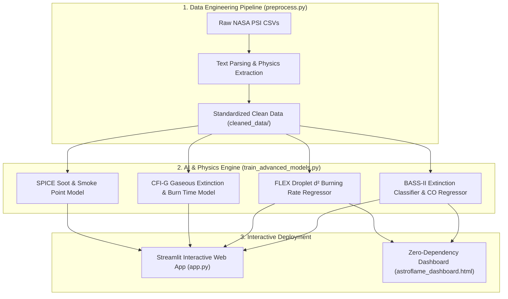

# 🔥 AstroFlame: NASA Microgravity Combustion & Spacecraft Fire Safety Simulator

[](https://python.org)
[](https://streamlit.io)
[](https://scikit-learn.org)
[](https://psi.nasa.gov)
[](LICENSE)

An end-to-end Machine Learning, Physics Simulation, and Interactive Decision Support System built on empirical microgravity combustion experiments conducted aboard the **International Space Station (ISS)** and drop towers by **NASA's Physical Sciences Informatics (PSI)** system.

---

## 🌌 The Scientific Challenge: Combustion in Free Fall

On Earth, hot combustion gases naturally rise due to buoyancy ($g \cdot \Delta \rho$), pulling fresh oxygen continuously into the reaction zone and elongating flames into the classic teardrop shape.

**In Microgravity (Free Fall, $g \approx 0$):**
1. **Buoyancy Extinction**: Natural convection disappears completely. Oxygen must reach the fuel exclusively through **molecular diffusion** or low-speed forced ventilation.
2. **Spherical Flame Geometry**: Symmetrical diffusion causes flames (droplets, candles) to become completely spherical.
3. **Cool Flames (Low-Temperature Chemistry)**: Hydrocarbon droplets and gas jets can sustain quasi-steady combustion at temperatures of ~600–1000 K without visible radiation, challenging conventional flammability limits.
4. **Spacecraft Fire Safety**: NASA requires rigorous predictive models to determine whether cabin ventilation speeds feed a fire or blow it off, and to estimate toxic Carbon Monoxide ($CO$) generation.

---

## 📊 Datasets from NASA Physical Sciences Informatics (PSI)

| Experiment | Code | Combustion Mode | Real Runs | Scientific Focus |
| :--- | :--- | :--- | :--- | :--- |
| **BASS-II** | `PSI-25` | Solid Materials | 129 | Solid material flammability (PMMA, Nomex, SIBAL) under forced cabin flow |
| **FLEX** | `PSI-69` | Liquid Droplets | 274 | Spherical droplet burning rate ($d^2$-law), extinction diameter, cool flame transitions |
| **CFI-G Normal** | `PSI-159` | Gaseous Alkanes | 179 | Normal co-flow diffusion flames, pressure effects (0.5 to 3.0 bar), self-extinction |
| **CFI-G Inverse** | `PSI-159` | Gaseous Inverse | 154 | Inverse diffusion flames ($O_2$ into fuel), burner peak temperatures |
| **SPICE** | `PSI-107` | Gaseous Jet | 469 | Smoke point soot emission and co-flow air critical velocity |

---

## 🏗️ System Architecture



---

## 🚀 Quickstart & Installation

### 1. Clone & Install Dependencies
```bash
git clone https://github.com/abdogebaly/AstroFlame.git
cd FlameInFreeFall
pip install pandas numpy scipy scikit-learn matplotlib plotly streamlit
```

### 2. Run the Interactive Streamlit App
```bash
streamlit run app.py
```
Visit `http://localhost:8501` in your browser.

### 3. AstroCommander AI Chatbot Setup (Gemini Flash)
The chatbot connects directly to **Google Gemini Flash** via the new `google-genai` SDK and integrates with live NASA NTRS and Images APIs:
1. Open the `.env` file in the project root:
   ```env
   GEMINI_API_KEY=your_actual_gemini_api_key_here
   ```
2. Get your free key from [Google AI Studio](https://aistudio.google.com/app/apikey).
3. The chatbot will dynamically detect your key — no server restart required!
4. If no key is set, the chatbot runs in offline mode using the embedded NASA combustion knowledge base.

### 4. Or Open the Instant Browser Dashboard
Double-click `astroflame_dashboard.html` in file explorer to launch the zero-install dashboard!

---

## 📈 Key Model Results & Performance

* **Spacecraft Fire Extinction Classifier (BASS-II)**:
  * Accuracy: **78.8%** | Precision for Safe Extinction: **93.9%**
  * Critical Findings: PMMA acrylic slabs sustain combustion in 100% of microgravity tests, whereas Nomex and SIBAL space fabrics exhibit >96% self-extinction.
* **Liquid Droplet Burning Rate Regressor (FLEX)**:
  * $R^2$ Score: **0.703** | Mean Absolute Error: **0.047 mm²/s**
  * Critical Findings: Helium ($He$) enhances burning rate (+0.40 correlation) due to 6x thermal conductivity, while Carbon Dioxide ($CO_2$) triggers radiation quenching (-0.37 correlation).

---

## 📜 Citation & Credits
Data provided by the **NASA Physical Sciences Informatics (PSI)** system:
- **BASS-II**: Principal Investigator Prof. Subrata Bhattacharjee (San Diego State University), Dr. Sandra Olson, Prof. James T'ien.
- **FLEX**: Principal Investigator Prof. Forman A. Williams (UC San Diego).
- **SPICE / CFI-G**: NASA Glenn Research Center combustion teams.
