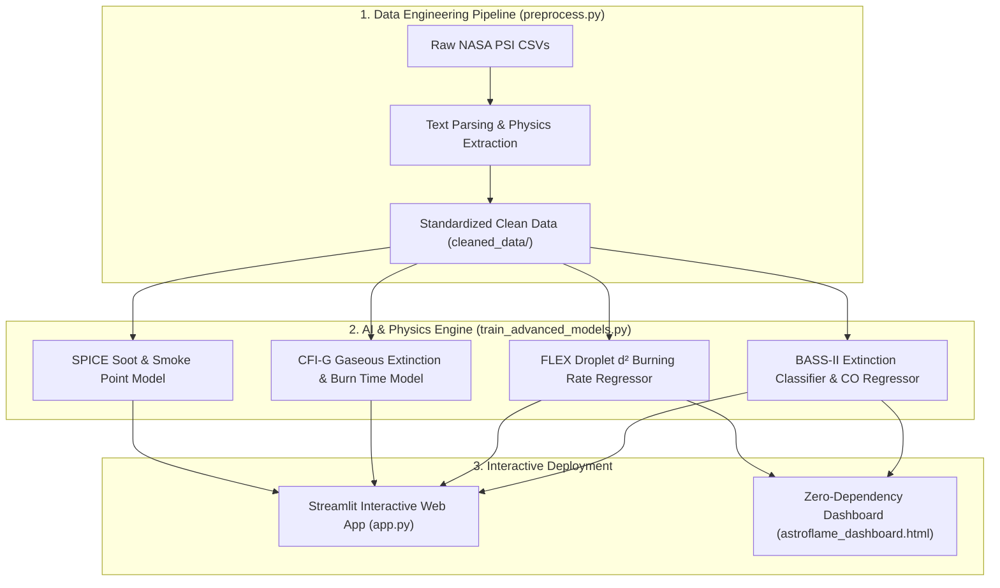

# 🔥 AstroFlame: NASA Microgravity Combustion & Spacecraft Fire Safety Simulator

[](https://python.org)
[](https://streamlit.io)
[](https://scikit-learn.org)
[](https://psi.nasa.gov)
[](LICENSE)

An end-to-end Machine Learning, Physics Simulation, and Interactive Decision Support System built on empirical microgravity combustion experiments conducted aboard the **International Space Station (ISS)** and drop towers by **NASA's Physical Sciences Informatics (PSI)** system.

---

## 🌌 The Scientific Challenge: Combustion in Free Fall

On Earth, hot combustion gases naturally rise due to buoyancy ($g \cdot \Delta \rho$), pulling fresh oxygen continuously into the reaction zone and elongating flames into the classic teardrop shape.

**In Microgravity (Free Fall, $g \approx 0$):**
1. **Buoyancy Extinction**: Natural convection disappears completely. Oxygen must reach the fuel exclusively through **molecular diffusion** or low-speed forced ventilation.
2. **Spherical Flame Geometry**: Symmetrical diffusion causes flames (droplets, candles) to become completely spherical.
3. **Cool Flames (Low-Temperature Chemistry)**: Hydrocarbon droplets and gas jets can sustain quasi-steady combustion at temperatures of ~600–1000 K without visible radiation, challenging conventional flammability limits.
4. **Spacecraft Fire Safety**: NASA requires rigorous predictive models to determine whether cabin ventilation speeds feed a fire or blow it off, and to estimate toxic Carbon Monoxide ($CO$) generation.

---

## 📊 Datasets from NASA Physical Sciences Informatics (PSI)

| Experiment | Code | Combustion Mode | Real Runs | Scientific Focus |
| :--- | :--- | :--- | :--- | :--- |
| **BASS-II** | `PSI-25` | Solid Materials | 129 | Solid material flammability (PMMA, Nomex, SIBAL) under forced cabin flow |
| **FLEX** | `PSI-69` | Liquid Droplets | 274 | Spherical droplet burning rate ($d^2$-law), extinction diameter, cool flame transitions |
| **CFI-G Normal** | `PSI-159` | Gaseous Alkanes | 179 | Normal co-flow diffusion flames, pressure effects (0.5 to 3.0 bar), self-extinction |
| **CFI-G Inverse** | `PSI-159` | Gaseous Inverse | 154 | Inverse diffusion flames ($O_2$ into fuel), burner peak temperatures |
| **SPICE** | `PSI-107` | Gaseous Jet | 469 | Smoke point soot emission and co-flow air critical velocity |

---

## 🏗️ System Architecture



---

## 🚀 Quickstart & Installation

### 1. Clone & Install Dependencies
```bash
git clone https://github.com/your-username/FlameInFreeFall.git
cd FlameInFreeFall
pip install pandas numpy scipy scikit-learn matplotlib plotly streamlit
```

### 2. Run the Interactive Streamlit App
```bash
streamlit run app.py
```
Visit `http://localhost:8501` in your browser.

### 3. Or Open the Instant Browser Dashboard
Double-click `astroflame_dashboard.html` in file explorer to launch the zero-install dashboard!

---

## 📈 Honest Model Validation

> AstroFlame is a **research & education tool**, not a certified safety or compliance system. The data are small (129–469 runs per experiment).

Run `python evaluate_grouped.py` to regenerate. Both columns are 5-fold out-of-fold results on all data; *unseen settings* holds out whole experimental settings (GroupKFold), the harder and more honest test.

| Model | Metric | Random split | Unseen settings | Confidence |
| :--- | :--- | :--- | :--- | :--- |
| BASS-II extinction | Accuracy | 82% | 84% | medium |
| BASS-II CO emission | R² | 0.45 | 0.40 | medium |
| FLEX burning rate | R² | 0.55 | 0.59 | medium |
| FLEX end mode | Accuracy | 78% | 78% | medium |
| CFI-G self-extinction | Accuracy | 89% | 90% | high |
| CFI-G burn time | R² | 0.50 | 0.54 | medium |
| SPICE smoke point | R² | 0.57 | 0.27 | low |

* **Where leakage mattered:** SPICE drops from R² 0.57 to 0.27 when settings are held out. Treat it as low confidence.
* **BASS-II CO** is indicative only (typical error ±84 ppm), so it is **not** part of the screening rule. The screening rule is P(self-extinction) ≥ 75%, a project-defined threshold, not a NASA standard.
* The server warns whenever inputs leave the range covered by the training data (computed per material or fuel) and returns HTTP 503 instead of made-up numbers if a model fails to load.

### Run the web app
```bash
pip install fastapi uvicorn pandas numpy scikit-learn joblib
python server.py        # http://127.0.0.1:8000
```

---

## 📜 Citation & Credits
Data provided by the **NASA Physical Sciences Informatics (PSI)** system:
- **BASS-II**: Principal Investigator Prof. Subrata Bhattacharjee (San Diego State University), Dr. Sandra Olson, Prof. James T'ien.
- **FLEX**: Principal Investigator Prof. Forman A. Williams (UC San Diego).
- **SPICE / CFI-G**: NASA Glenn Research Center combustion teams.
